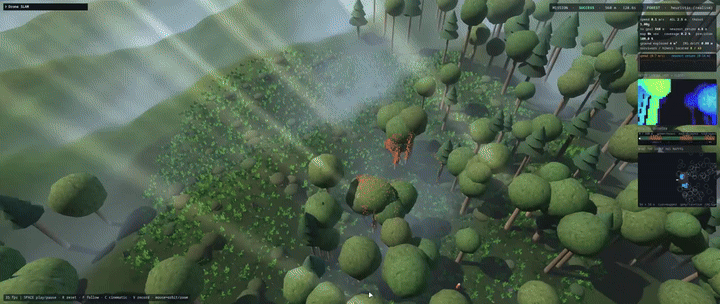
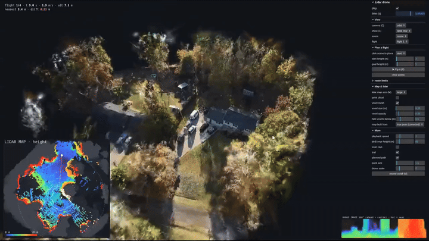

# Drone-SLAM

RL-flown drones that map the world around them while their navigation drifts. Two projects live in this repo and share the same quadrotor dynamics, noisy lidar model, INS drift and mapping viewer:

| | **DroneForest** (terrain) | **SplatDrone** (Gaussian splat) |
|---|---|---|
| World | procedural forests and disaster zones | a real captured 3D Gaussian splat |
| Collision geometry | analytic trunks, canopies, boxes, heightfield | signed distance field voxelised from the splat |
| Flown by | PPO policy (teacher + imitation + curriculum) or a heuristic flyer | reference flyer following an A* path through the splat's free space |
| Output | three.js viewer with live SLAM map and mesh | splat viewer with point cloud, voxel mesh and top-down height map |

Everything runs on a laptop GPU (RTX 3050 mobile, 4 GB) or on CPU. The sim is batched torch tensors, no Isaac or Omniverse.

## Demos

### DroneForest



### SplatDrone




## Repo layout

```
Drone-SLAM/
├── README.md
├── requirements.txt
├── media/                 demo videos and GIFs shown above
│   ├── terrain/
│   └── splat/
├── docs/                  extra notes
└── droneforest/           all code; run every command below from here
    ├── terrain.py         analytic heightfield (same maths in torch and in the viewer's JS)
    ├── dynamics.py        batched quadrotor, collective-thrust + body-rate actions, inner rate loop
    ├── world.py           per-env forest and disaster zone, batched raycasts, collisions
    ├── env.py             observations (97-d), reward, curriculum, scan-gated imitation reward
    ├── ppo.py             minimal PPO (own loop)
    ├── heuristic.py       hand-written reference flyer, used for demo rollouts and sanity checks
    ├── train.py           teacher | forest | baseline
    ├── eval.py            benchmark a policy across forest densities
    ├── rollout.py         run a policy, export viewer/data/rollout.json
    ├── mission.py         long procedural forest <-> disaster-zone mission
    ├── viewer/            three.js viewer for DroneForest (vendored, works offline)
    ├── splat/             SplatDrone: proxy, SDF world, planner, follower, env
    ├── splat_viewer/      viewer for SplatDrone
    ├── run_splat.py       build a splat scene and fly it
    ├── plan_server.py     serves the splat viewer and plans / flies on demand
    ├── asteroid/, asteroid_viewer/, run_asteroid.py    see docs/other-modules.md
    └── runs/              training logs, checkpoints and result tables
```

## Install

```bash
pip install -r requirements.txt
cd droneforest
```

---

# Project 1: DroneForest (terrain)

A quadrotor learns to fly through a procedural forest with PPO, using a **frozen teacher + scan-gated imitation reward** and a **per-env adaptive curriculum**. A three.js viewer shows the flights with a live depth camera, a voxel SLAM map and its surface mesh.

## How it works

| Idea | Implementation |
|---|---|
| Frozen open-field policy as teacher | stage 1 trains a flyer in open terrain, then freezes it |
| Scan-gated imitation reward | penalise `|a - a_teacher|^2` only where the range scan shows free space (`gate` in `env.py`); the teacher sees a ground-only scan, so trees never confuse it |
| Per-env adaptive curriculum | each env has its own forest density (`level`), +0.04 on success, -0.04 on crash |
| Range scan | 80 rays (16 azimuth x 5 elevation), analytic raycasts in torch |
| Scan is required to succeed | obstacles are placed on the start-goal corridor |
| Privileged critic | the critic sees clean ground truth, the deployed policy sees noisy sensors (`PRIV_DIM` in `env.py`, `ActorCritic(critic_dim=...)` in `ppo.py`) |
| Sensor and dynamics realism | `env(realism=True)`: range noise growing with distance, 3 % dropouts, gyro and velocity noise, 1-step latency, OU wind gusts, per-env thrust, drag and time-constant randomisation |
| GPS-denied flight | position-estimate random-walk drift in the observation (`drift`); the viewer builds the map from the drifting pose |

## Run

```bash
# 1) open-field flyer = the frozen teacher
python train.py --stage teacher --iters 600 --envs 1024

# 2a) forest, initialised from the teacher + scan-gated imitation
python train.py --stage forest --teacher runs/teacher/model.pt --il-weight 0.5
# 2b) ablations
python train.py --stage forest --teacher runs/teacher/model.pt --il-weight 0   # init only
python train.py --stage baseline                                               # from scratch

# 3) export flights and look at them
python rollout.py --policy runs/forest/model.pt --level 0.8
cd viewer && python -m http.server 8000      # open http://localhost:8000
```

`python rollout.py --policy heuristic` makes demo flights without any training (a demo set is already in `viewer/data/`).
Training writes `runs/<stage>/log.csv` (reward, success, collision, curriculum level). If you hit GPU memory limits, lower `--envs` (512 is fine on 4 GB).

With sensor realism and drift:

```bash
python train.py --stage teacher --realism
python train.py --stage forest --teacher runs/teacher/model.pt --realism --out runs/forest_il
python train.py --stage baseline --realism --out runs/baseline
python eval.py --policy runs/forest_il/model.pt --realism && python eval.py --policy runs/baseline/model.pt --realism
python rollout.py --policy runs/forest_il/model.pt --realism --drift 0.2 --device cuda
```

## Disaster zone and long SLAM mission

```bash
python mission.py --seed 11 --length 560                                               # long forest <-> disaster flight -> viewer/data/mission.json
python rollout.py --scene disaster --policy heuristic --out viewer/data/disaster.json  # short arena episodes
python train.py --stage forest --teacher runs/teacher/model.pt --scene mixed           # train on forest + ruins
cd viewer && python -m http.server 8000     # / (mission)   ?data=disaster   ?data=rollout   ?cine=1   ?nopost=1
```

* **Sim**: `world.py` has axis-aligned box obstacles (broken walls, rubble, fallen slabs, wrecked vehicles) with slab-method raycasts, collision and clearance. `--scene forest|disaster|mixed` works in train, eval and rollout.
* **mission.py**: a seeded world of alternating forest and ruin biomes along a wandering route, with buildings, vehicles, logs, poles, stumps, fires and survivors. Seeds are retried until the flight completes. It is flown by the heuristic flyer (or `--policy`) at a moving look-ahead waypoint, with wind and INS drift.

## Viewer

Controls: SPACE play/pause, R reset, N/P episode, F follow, mouse orbit/zoom, drag a `rollout.json` onto the window, C cinematic camera, V record WebM.
URL params: `?ep=2&t=8&noshadows=1`. The world (terrain and trees) is exactly what the policy flew in.

* **Mapping scorecard**: surface coverage (share of the arena's true surfaces the map has captured), map precision (share of mapped voxels on a true surface, +-1 voxel), ground explored (m^2), INS drift now.
* **Drifting-pose mapping**: the map is built from the drifting estimate, so with drift you see ghosted trees and precision falls. Toggle it to compare with a perfect pose. Range noise degrades precision the same way.
* Fog-of-war on unmapped ground, minimap (explored cells, mapped obstacles, true trees, true path vs believed path, depth-camera FOV), depth-camera image, telemetry and speed / nearest-return plot.
* Chunked SLAM mesh that flashes in as it is mapped, scan pulse, FOV cone, survivor detection with pins, and a mission overview strip.
* **Export map (.ply)** downloads the occupied voxels as a coloured point cloud.

## Limits

* The SLAM map is a voxel occupancy map built from the simulated depth camera with the drifting pose. It is mapping, not full SLAM.
* The heuristic flyer, not a learned policy, flies the long mission. The box obstacles are not yet trained on (heuristic success on dense disaster arenas is modest) and are axis-aligned.
* The policy observes the 80-ray range scan, not depth images. A CNN on depth images is the natural next step.
* Sun shafts are a cheap additive-beam effect, and contact-shadow decals replace screen-space AO.

---

# Project 2: SplatDrone (Gaussian splat)

A lidar drone flies through a real captured Gaussian splat with drifting navigation. The lidar builds a point cloud, a voxel mesh and a top-down height map live as it flies.

## How it works

Splats have no hard geometry, so the sim needs a collision proxy:

1. `splat/proxy.py` orients and scales the capture to a z-up metric frame (floor at z=0), drops floaters, voxelises the opaque Gaussians (default 0.2 m), removes small blobs and takes a signed distance field.
2. `splat/world.py` exposes that SDF through the same interface as the procedural forest: collisions are SDF < drone radius, lidar is sphere tracing through the SDF. Observation, dynamics, noise, drift, wind and latency are unchanged.
3. Start and goal pairs come from an A* path through the free space (`splat/plan.py`). The reference flyer (`splat/follow.py`, privileged: it reads the SDF) follows that path.
4. The viewer renders the same transformed splats with the [GaussianSplats3D](https://github.com/mkkellogg/GaussianSplats3D) renderer (`splat_viewer/vendor/`, MIT) and replays the exported poses and 80-ray lidar ranges.

## Run

```bash
python run_splat.py --demo                                    # stand-in procedural splat scene (NOT a real capture) to test the pipeline
python run_splat.py --scene my_scan.ply --up=-y --scale 1.0   # your own 3DGS .ply or .splat; --up = which axis of the capture points up (COLMAP-style: -y)
python -m http.server 8000                                    # open http://localhost:8000/splat_viewer/   (?scene=<name>)
```

**The repo ships only the synthetic demo scene.** Real captures are large and are not redistributed, so bring your own `.ply` or `.splat`.

## Choosing start / end points, heights and collision safety

```bash
python run_splat.py --scene splat.ply --up=-y --scale 4 --fill-down --voxel 0.4 --start 12 -5 8 --goal 40 20 15   # exact points, z = metres above the floor
python run_splat.py ... --start 12 -5 3 --goal 40 20 3 --agl                                                     # z = metres above the local roof / canopy / ground
python run_splat.py ... --start-z 6 10 --goal-z 15 25 --ceiling 40                                               # random pairs inside height bands
```

* Click the **lidar heat map** in the viewer to get coordinates (click = start, shift+click = end; height = surface + the "pick height" slider) and paste the printed `--start ... --goal ...`.
* Points inside geometry are moved to the nearest free spot and reported. `--ceiling` lets the route fly over obstacles.
* Safety knobs: `--margin` (planner clearance, default 1.2 m), `--radius` (drone collision radius, 0.35 m), `--thr` / `--min-opacity` (lower = thicker proxy).
* Every flight is also checked independently against the raw opaque splat centres: closer than `--splat-clear` (0.5 m) and it is rejected and not exported.

## Interactive planning (no re-running run_splat.py)

```bash
python run_splat.py --scene splat.ply ... --name splat     # once, to build the scene + collision proxy
python plan_server.py                                      # serves the viewer AND plans / flies on demand
```

Open `http://localhost:8000/splat_viewer/`. In the **Plan a flight** panel, click the splat in 3D to place the start and then the goal (the pin lands on the surface under the cursor), and set heights with the sliders (or Q / E, Shift+Q / Shift+E). The route is planned live (cyan line, also on the heat map), and the panel tells you why a route is impossible (raise *max altitude*, lower *keep-out margin*). **Fly it (F)** runs the full simulation with the splat-distance check and adds it as a new flight. Without the server the viewer just prints the `--start ... --goal ...` command.

## Viewer

* Dense accumulated **point cloud** and **voxel mesh** (size, opacity and hide-below sliders) from a 360° 90x10 mapping lidar.
* Top-down **heat map** of mapped surface height, with the live scan, the 20 m range ring, the planned route and your start / goal. Size small / large / huge with M.
* Live 360° **range image**, persistent SLAM point map switchable between corrected and drifting pose, trail, planned path, WebM recording.
* Cameras: orbit, follow, chase, side, birdseye (top-down, wheel = height), overview, cinematic (C cycles). Scan rays are off by default.

## Limits

* Scale and up-axis of a capture are arbitrary: check that the printed extent is in metres and the grid looks sensible.
* The lidar hits the proxy, not the Gaussians themselves, so it is accurate to about one voxel.
* The floor is a flat plane at the lowest 1 % of the scene. Indoor or uneven ground may need `--floor`.
* The proxy is only as good as the splat's opacity: raise `--voxel` and lower `--thr` for sparse scans.
* The flyer in this project is a privileged reference follower that reads the SDF. The RL policy is not yet trained inside splat scenes.

---

## Also in this repo

An asteroid proximity-ops mapping demo (spinning procedural asteroids, drifting navigation, scan-matching SLAM, active orbit planning). See [docs/other-modules.md](docs/other-modules.md).

## Credits

* [GaussianSplats3D](https://github.com/mkkellogg/GaussianSplats3D) by Mark Kellogg (MIT), vendored in `splat_viewer/vendor/`.
* [three.js](https://threejs.org) (MIT), vendored in the viewers.
* Real splat scene by Marvin Rosario, used for the demo video and not included in this repo.
